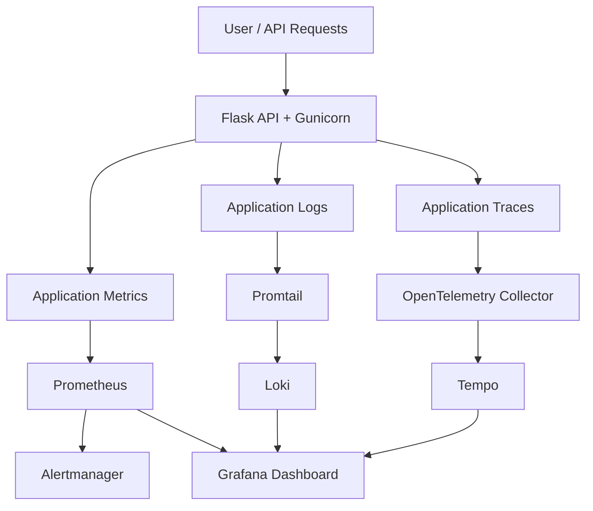

# Full-Stack Observability & SRE Lab

A hands-on Site Reliability Engineering (SRE) project demonstrating application monitoring, centralized logging, distributed tracing, alerting, and Kubernetes resilience testing using open-source observability tools.

## Overview

This project implements an observability stack for a Python Flask API. It brings together metrics, logs, traces, and alerting to help understand application health, investigate failures, and validate recovery behavior.

### Key Features

- **Metrics monitoring:** Collect and query application metrics using Prometheus.
- **Visualization:** Monitor service health and performance through Grafana dashboards.
- **Centralized logging:** Collect and explore logs using Loki and Promtail.
- **Distributed tracing:** Use OpenTelemetry Collector and Tempo to explore application traces.
- **Alerting:** Configure Prometheus alert rules and Alertmanager for service failures and elevated error rates.
- **Chaos engineering:** Use Chaos Mesh to terminate a Kubernetes pod and verify Kubernetes self-healing.
- **Testing:** Include application tests to support validation of the Flask API.

## Technology Stack

| Category | Tools |
|---|---|
| Application | Python, Flask, Gunicorn |
| Metrics | Prometheus |
| Dashboards | Grafana |
| Logging | Loki, Promtail |
| Tracing | OpenTelemetry Collector, Tempo |
| Alerting | Prometheus Alert Rules, Alertmanager |
| Containers | Docker, Docker Compose |
| Kubernetes resilience | Kubernetes, kind, Chaos Mesh |
| Testing | pytest |

## Architecture



*Architecture overview: Grafana brings together metrics, logs, and traces, while Prometheus alert rules send notifications through Alertmanager. The diagram represents the intended data flow; verify individual instrumentation and configuration details against the deployed stack.*

## Project Structure

```text
full-stack-observability-sre-lab/
├── alertmanager/
├── app/
├── docs/
├── evidence/
│   └── chaos-mesh/
├── grafana/
│   ├── dashboards/
│   └── provisioning/
├── loki/
├── otel-collector/
├── prometheus/
│   └── rules/
├── tempo/
├── tests/
├── Dockerfile
├── docker-compose.yml
├── requirements.txt
└── README.md
```

## Application Endpoints

The Flask API provides the following endpoints:

| Endpoint | Purpose |
|---|---|
| `/` | Application endpoint |
| `/health` | Health check |
| `/work?delay=...` | Exercise a request with a configurable delay |
| `/metrics` | Expose metrics for Prometheus scraping |

Use the configured application port and confirm the endpoint behavior in `app/app.py`.

## Observability Capabilities

### Metrics and dashboards
- Scrape application metrics using Prometheus.
- Configure alert rules for API availability and elevated error rates.
- Visualize service health through the Grafana dashboard.

### Logging
- Collect logs using Promtail.
- Store and query logs in Loki.
- Investigate application behavior during failures.

### Distributed tracing
- Use the OpenTelemetry Collector to process telemetry.
- Store traces in Tempo.
- Investigate request execution and latency where tracing instrumentation is configured.

### Alerting
- Configure Prometheus alert rules.
- Route alerts through Alertmanager.
- Validate the API-down alert by stopping the application and observing the alert, then restarting the application.

## Chaos Engineering Experiment

A separate Kubernetes experiment validates pod failure and deployment recovery.

**Environment**
- Kubernetes cluster: kind
- Chaos Mesh version: 2.8.6
- Workload: Nginx deployment
- Namespace: `chaos-lab`
- Experiment: Pod-kill

**Observed results**
1. Chaos Mesh successfully injected a pod-kill fault against the original Nginx pod.
2. Kubernetes created a replacement pod through the ReplicaSet.
3. The replacement pod reached `Running` and `Ready`.
4. The deployment returned to one available replica.
5. During cleanup, Kubernetes events recorded successful chaos recovery and finalizer removal.

The experiment's recovery status initially remained stale. Recovery was subsequently recorded during cleanup, so the result validates pod-kill behavior and Kubernetes self-healing, not every Chaos Mesh experiment type.

Evidence is available in `evidence/chaos-mesh/`.

## Setup and Validation

Prerequisites:
- Docker Engine or Docker Desktop
- Docker Compose
- Git

Clone the repository:

```bash
git clone https://github.com/rinas-ck/full-stack-observability-sre-lab.git
cd full-stack-observability-sre-lab
```

Review the Compose configuration and environment requirements before starting the stack:

```bash
cat docker-compose.yml
cat README.md
```

If the Compose configuration requires no additional setup, start the stack with:

```bash
docker compose up -d --build
```

Inspect service status and logs:

```bash
docker compose ps
docker compose logs --tail=100
```

Use the configured ports in `docker-compose.yml` to open Grafana and other services. Do not assume default ports if the Compose file overrides them.

To stop the stack:

```bash
docker compose down
```

## Testing

Run the Python tests in an environment with the project dependencies installed:

```bash
python3 -m pip install -r requirements.txt
python3 -m pytest -v
```

If your environment uses a virtual environment, activate it before installing dependencies or running tests.

## Documentation and Evidence

Additional project documentation is available in:

- `docs/architecture.md` — architecture documentation
- `docs/incident-report.md` — incident report
- `docs/reflection.md` — project reflection
- `evidence/chaos-mesh/` — pod-kill experiment evidence and recovery observations

## Learning Outcomes

This project provides hands-on experience with:

- Observability across metrics, logs, and traces.
- Prometheus alert rules and Alertmanager.
- Grafana dashboard provisioning.
- Containerized application deployment.
- Failure investigation and service recovery.
- Kubernetes self-healing and controlled chaos experiments.

## Author

**Muhammad Rinas**

Aspiring Cloud & DevOps Engineer | AWS | Docker | Kubernetes | Terraform | Prometheus | Grafana | CI/CD

GitHub: [rinas-ck](https://github.com/rinas-ck)
